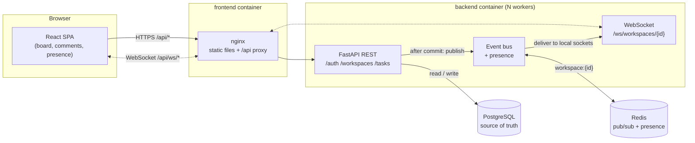

# CollabSpace

[](https://github.com/Pratham01111/CollabSpace/actions/workflows/ci.yml)

A real-time collaborative Kanban workspace. Teams share boards, edit tasks and
comment, and every change appears on everyone's screen as it happens. Two people
editing the same task at once never silently overwrite each other.

## Live Demo

> _Coming soon — link to the deployed app._

## Screenshots

> _Coming soon._
>
> | Board | Task detail | Mobile |
> | --- | --- | --- |
> | `docs/screenshots/board.png` | `docs/screenshots/task.png` | `docs/screenshots/mobile.png` |

## Features

- **Accounts:** register and log in with email and password. Passwords are hashed
  with bcrypt, and sessions use JWT bearer tokens.
- **Workspaces and roles:** OWNER, ADMIN and MEMBER, with rules for who may add or
  remove people and grant roles. A workspace always keeps at least one owner.
- **Members panel:** on the board, list members with their roles and see who is
  online. Owners and admins add people by email and remove them, within the role
  rules. Anyone can leave. Every open board updates its member list live.
- **Private by default:** a workspace you don't belong to, and everything in it,
  returns 404. A 403 would confirm that it exists.
- **Kanban board:** TODO / IN PROGRESS / DONE. Create, edit, delete, and drag
  between columns.
- **Comments:** each task has a comment thread.
- **Real-time sync:** task changes and comments reach every open board over
  WebSockets, without reloading.
- **Presence:** "Online now" and "*N* users online", correct across several tabs
  and several servers.
- **Conflict-safe editing:** optimistic concurrency control. A stale edit is
  refused with a 409 and the latest version, never written over someone else's.
- **Resilient connection:** reconnects with backoff and resyncs after a server
  restart or network drop. The UI shows Connected / Reconnecting… / Offline.
- **Horizontally scalable:** several backend processes or servers share events
  and presence through Redis pub/sub.
- **Production basics:** one error format everywhere, structured JSON logs with
  request ids, input bounds, a 503 when the database is down, and loading, error
  and empty states. The UI works at phone width.
- **Tooling:** one-command Docker setup, about 215 backend tests, and CI on every
  push.

## Tech Stack

| Layer | Technology |
| --- | --- |
| Frontend | React 18, React Router, Vite, Axios, plain CSS |
| Backend | Python 3.14, FastAPI, Uvicorn, Pydantic |
| Database | PostgreSQL 17, SQLAlchemy 2.0, Alembic |
| Real-time | WebSockets (Starlette), Redis 7 pub/sub |
| Auth | JWT (PyJWT, HS256), bcrypt |
| Infrastructure | Docker, Docker Compose, nginx |
| Testing / CI | pytest, httpx TestClient, GitHub Actions |

## Architecture



- **The browser only talks to nginx.** nginx serves the built app and proxies
  `/api/*`, the WebSocket included, to the backend. There is one origin, so no
  CORS, and no backend address is built into the JavaScript.
- **PostgreSQL is the only source of truth.** Redis carries messages and
  short-lived presence data between backend processes, and persists nothing.
- **Every backend process holds only its own sockets.** Events go through Redis,
  so a change handled by one process reaches users connected to any other.

## How It Works

**HTTP is for doing things; the WebSocket is for hearing about them.**

1. **Reads and writes go over REST.** The client calls e.g.
   `PATCH /api/tasks/42` with a bearer token. FastAPI checks the token and the
   caller's membership, validates the body, and writes to Postgres.
2. **The event goes out only after the commit.** The route queues the broadcast
   as a background task. FastAPI runs background tasks only after the handler
   succeeds, so a rejected request or a failed commit never produces an event,
   and clients never see state that isn't in the database.
3. **Fan-out goes through Redis.** The event is published on `workspace:{id}`.
   Every backend process is subscribed and forwards it to its own connected
   sockets for that workspace, including the process that published it. That
   gives one delivery path, so there are no duplicates.
4. **The client applies events to local state.** It has a socket open at
   `/ws/workspaces/{id}?token=…`, and a `switch` on `event.type` adds, replaces
   or removes the task or comment, with no refetch:
   - The same change can arrive twice (your own REST response plus the
     broadcast), so updates are de-duplicated by id.
   - An older `version` never overwrites a newer one.
5. **Reconnects resync.** When the socket drops (server restart, network loss),
   the client retries with jittered backoff: 1s, 2s, 4s … capped at 30s, six
   attempts, then Offline with a Retry button. Events sent during the gap are
   lost, so every reconnect re-reads the board over REST once.
6. **Presence.** Each server records which users it has connected in a Redis
   sorted set, refreshed by a heartbeat. `USER_JOINED` fires on someone's first
   connection anywhere, and `USER_LEFT` when their last one closes. If a server
   crashes, its users expire and are announced as gone.

## Concurrency

Two people open the same task (version 4), and both edit it. Without a check,
whoever saves second silently erases the first person's change. CollabSpace uses
**version-based optimistic concurrency control**:

- Every task has a `version`. Every update must say which version it was based on:

  ```http
  PATCH /tasks/42
  {"status": "DONE", "expected_version": 4}
  ```

- If the task is still at version 4, the update applies, `version` becomes 5, and
  `TASK_UPDATED` is broadcast.
- If someone got there first, the response is **409 Conflict**. Nothing is written
  or broadcast, and the body carries the task as it is now (`current_task`). The
  UI shows *"This task was updated by someone else — showing the latest
  version"*, loads that version into the form, and lets you redo the edit. There
  is no automatic merging.

**The check is part of the write itself, so it can't race:**

```sql
UPDATE tasks SET ..., version = version + 1
WHERE id = :id AND version = :expected_version
```

A "read the version, compare, then write" approach would let two simultaneous
requests both pass the comparison. With the condition inside the `UPDATE`,
Postgres makes the second writer wait for the first to commit, then re-checks
the `WHERE` against the new row. It no longer matches, zero rows change, and the
second request gets a 409. The tests show this with eight truly concurrent
writers: exactly one succeeds. They also fail if the version condition is removed.

**On the client:**

- The form sends the version it was **loaded with**, not the live one. Otherwise
  an edit started before a teammate's save would quietly win.
- While someone else's save is pending against your unsaved edits, the form warns
  you that saving will be refused.

## Running Locally

**Requirements**

| Path | Needs |
| --- | --- |
| Docker | Docker with Compose v2 (`docker compose`). Nothing else: Python and Node run inside the images. |
| Native development | Python **3.14** (3.11 is the minimum the code supports; the image and CI use 3.14), Node.js **22** (CI and the image use 22; 20 or later works with Vite 6), and Docker for Postgres and Redis. |

### Everything in Docker (recommended)

```bash
cp .env.example .env
docker compose up --build
```

| What | Where |
| --- | --- |
| App | http://localhost:8080 |
| API docs (Swagger) | http://localhost:8000/docs |

Startup order is gated on health checks: Postgres and Redis, then the backend
(which runs `alembic upgrade head` first), then the frontend.

- **Configuration:** every setting and secret comes from `.env`. Compose refuses
  to start without `POSTGRES_*` and `JWT_SECRET_KEY`.
- **Change `JWT_SECRET_KEY`** for anything beyond local use.
- **Passwords with special characters:** if `POSTGRES_PASSWORD` contains
  `@ : / ? #`, percent-encode it.

```bash
docker compose down        # stop, keep data
docker compose down -v     # stop and delete the database volume
```

### Native development (hot reload)

Run the data services in Docker and the apps directly:

```bash
cp .env.example .env                  # once; Postgres credentials for compose
docker compose up -d postgres redis

# backend: http://localhost:8000
cd backend
python3 -m venv .venv && source .venv/bin/activate
pip install -r requirements-dev.txt
cp .env.example .env                  # then set JWT_SECRET_KEY
alembic upgrade head
uvicorn app.main:app --reload --port 8000

# frontend: http://localhost:5173
cd frontend
npm install
npm run dev
```

If the Docker backend is also running, stop it first: `docker compose stop backend frontend`.

### Configuration

| Variable | Default | Purpose |
| --- | --- | --- |
| `DATABASE_URL` | local Postgres | SQLAlchemy URL (built by compose from `POSTGRES_*`) |
| `JWT_SECRET_KEY` | none, required | signs access tokens |
| `ACCESS_TOKEN_EXPIRE_MINUTES` | `60` | token lifetime |
| `REDIS_URL` | `redis://localhost:6379/0` | empty = single process, in-memory events |
| `CORS_ORIGINS` | `http://localhost:5173` | comma-separated; not needed behind nginx |
| `BACKEND_WORKERS` | `2` | uvicorn worker processes (compose) |
| `DB_POOL_SIZE` / `DB_MAX_OVERFLOW` | `5` / `10` | connection pool per worker |
| `DB_POOL_TIMEOUT` / `DB_POOL_RECYCLE` | `10` / `1800` s | fail fast; recycle idle connections |
| `LOG_LEVEL` / `LOG_FORMAT` | `INFO` / `json` | `text` for readable local logs |
| `VITE_API_BASE_URL` | `http://localhost:8000` | frontend build; `/api` in Docker |
| `VITE_ENABLE_GUEST` | `false` | "Continue as guest" in production builds |

## Testing

```bash
docker compose up -d postgres redis
cd backend && pytest
```

About 215 tests in about 15 seconds, organised by feature:

| File | Covers |
| --- | --- |
| `test_auth.py` | registration rules; wrong password and unknown email are indistinguishable; expired, forged, `alg: none`, malformed and missing tokens |
| `test_authorization.py` | every workspace, task and comment endpoint returns 404 to outsiders, identical to a missing resource; role rules; the last-owner rule |
| `test_workspaces.py`, `test_tasks.py`, `test_comments.py` | CRUD, validation, server-owned fields, ordering |
| `test_websockets.py` | accept and reject (4401 / 4404), socket cleanup, task, comment and membership events reaching clients, workspace isolation, failed requests broadcasting nothing |
| `test_task_concurrency.py` | optimistic concurrency, including eight truly simultaneous writers |
| `test_event_bus.py`, `test_presence.py` | fan-out and presence across two simulated servers on a real Redis |
| `test_production.py` | error format, no input echo, id and number bounds, 500/503 handling, log contents, WebSocket edge cases |

**How the tests run:**
- **Separate database:** they use `<database>_test`, created automatically and
  emptied after every test. They refuse to touch any database whose name doesn't
  end in `_test`.
- **No leaked sockets:** a fixture fails any test that leaves a WebSocket
  registered.
- **Speed:** bcrypt runs at a lower cost under test, since nothing depends on the
  work factor.
- **The tests catch real bugs:** the suite was checked by deliberately breaking
  five security and correctness rules, one at a time; it failed each time.

**CI:** `.github/workflows/ci.yml` runs on every push and pull request:
- **Backend:** Postgres and Redis service containers, `alembic upgrade head`,
  then `pytest`.
- **Frontend:** `npm ci` and `npm run build`.

---

## API Reference

The interactive docs at `/docs` list every route, with its parameters and the
error responses it can return. The essentials:

### Errors

Every error, whatever produced it, has the same body:

```json
{ "detail": "Human-readable message.", "code": "not_found", "request_id": "4f9c2a1b7d3e8a06" }
```

- **`request_id`** is also in the `X-Request-ID` response header, and on every log
  line for that request.
- **422s** add `errors: [{"field", "message"}]`. They never echo the submitted
  value, which for a rejected password would mean repeating it.
- **Unexpected failures** are a generic 500; the traceback goes only to the log.
- **A lost database connection** is a 503 (`database_unavailable`). The
  connection pool replaces dead connections, so it clears as soon as the database
  is back.

| Code | When |
| --- | --- |
| `unauthorized` (401) | missing, invalid or expired token |
| `forbidden` (403) | your role doesn't allow it |
| `not_found` (404) | doesn't exist, or isn't visible to you |
| `conflict` / `version_conflict` (409) | duplicate, last-owner rule, or a stale task edit (adds `current_task`) |
| `validation_error` (422) | invalid input |
| `database_unavailable` (503) | database unreachable |

### Auth

| Endpoint | Notes |
| --- | --- |
| `POST /auth/register` | `{email, password}` → 201. Email normalised; password 8 to 72 bytes; 409 if taken |
| `POST /auth/login` | → `{access_token, token_type, expires_in}`; one 401 for any bad credentials |
| `GET /auth/me` | the current user |

Send the token as `Authorization: Bearer <token>`. Tokens are HS256, carry only
the user id, and expire after `ACCESS_TOKEN_EXPIRE_MINUTES`. There are no refresh
tokens yet.

### Workspaces

| Endpoint | Who |
| --- | --- |
| `POST /workspaces` | anyone signed in; the creator becomes OWNER |
| `GET /workspaces` | your workspaces, with your role in each |
| `GET /workspaces/{id}` | members; includes the member list |
| `POST /workspaces/{id}/members` | owner or admin; `{email}` or `{user_id}`, optional `role` |
| `DELETE /workspaces/{id}/members/{user_id}` | owner or admin |
| `DELETE /workspaces/{id}/members/me` | any member, to leave |

**Role rules:**
- Only an owner can grant ADMIN or OWNER, and only an owner can remove an owner.
- The last owner can't be removed and can't leave.
- A removed member's open WebSockets are closed with 4404.

### Tasks

| Endpoint | Notes |
| --- | --- |
| `GET /workspaces/{id}/tasks` | in board order (status, then position) |
| `POST /workspaces/{id}/tasks` | `{title, description?, status?, position?}`; `created_by` comes from the token |
| `PATCH /tasks/{id}` | partial update; **requires `expected_version`**; 409 if stale |
| `DELETE /tasks/{id}` | also deletes its comments |

**Fields and limits:**
- **Limits:** titles 1 to 255 characters, descriptions up to 10,000.
- **Server-owned fields:** `created_by`, `version`, `workspace_id` and the
  timestamps. Sending any of them is a 422.
- **`position`:** a finite float that orders cards within a column. When it's
  omitted, the card goes to the bottom of its column. A float lets a drop between
  two cards be a single write at their midpoint.

### Comments

| Endpoint | Notes |
| --- | --- |
| `GET /tasks/{id}/comments` | oldest first |
| `POST /tasks/{id}/comments` | `{body}`, 1 to 5000 characters; the author comes from the token |

### WebSocket

`/ws/workspaces/{id}?token=<access_token>`. The token goes in the query string
because browsers can't set headers on a WebSocket. Server logs never include
query strings.

| Server → client | When |
| --- | --- |
| `connected` | right after connecting: `{workspace_id, user_id, online_users}` |
| `TASK_CREATED` / `TASK_UPDATED` / `TASK_DELETED` | after a committed task write; `{task}` |
| `COMMENT_CREATED` | after a committed comment; `{comment}` |
| `USER_JOINED` / `USER_LEFT` | someone's first connection opens or last one closes; `{user}` |
| `MEMBER_ADDED` / `MEMBER_REMOVED` | after a committed add, or a removal or leave; `{member}` / `{user_id}` |
| `pong` | in reply to the text `ping` |

| Close code | Meaning | Client behaviour |
| --- | --- | --- |
| `4401` | bad or expired token | log out |
| `4404` | not a member (or removed) | stop retrying |
| `1012` / `1013` | server restart / try again later | reconnect with backoff |

### Logging

Logs are one JSON object per line on stdout (`LOG_FORMAT=text` for local
readability). Every line within a request carries its `request_id`.

**Events logged:**
- requests (method, path, status, duration)
- auth: login success and failure, token rejected, registration
- WebSockets: connected, disconnected, rejected
- version conflicts and membership changes
- database outages and unhandled errors, with tracebacks

Passwords, tokens and query strings are never logged.

## Database

| Table | Notes |
| --- | --- |
| `users` | unique `email` |
| `workspaces` | |
| `workspace_members` | unique `(workspace_id, user_id)`, with `role` |
| `tasks` | `status` enum, float `position`, `version` for concurrency |
| `comments` | indexed on `(task_id, created_at)` |

**What deleting cascades to:**
- A workspace takes its members and tasks with it.
- A task takes its comments.
- A user takes their memberships and comments. Their tasks remain, with
  `created_by` set to null.

Schema changes go through Alembic (`alembic revision --autogenerate -m "..."`,
then review the result before applying it with `alembic upgrade head`).

## Frontend Notes

**Loading, errors and empty states:**
- **Loading:** skeletons on the first load of the dashboard and board, and a
  spinner for comments. Refresh keeps the board on screen.
- **Failed loads:** an error box with **Try again**. Errors from actions such as
  a failed move are dismissible, and the move is rolled back.
- **Crashes:** a render error shows a recovery screen instead of a blank page.
- **Empty states:** "No workspaces yet", and "No tasks" in an empty column.

**Responsive:**
- Columns stack below 800px.
- The header truncates long emails.
- The task dialog fits phone screens.
- Phones can't drag, so tasks move with the Status dropdown in the task detail.

**Guest mode:** for development only, "Continue as guest" creates a throwaway
account with a demo board. It's on in `npm run dev`, and a production build needs
`VITE_ENABLE_GUEST=true`.

## Project History

Built in phases:
1. Project setup.
2. Database.
3. Authentication.
4. Workspaces.
5. Tasks.
6. Frontend.
7. WebSockets.
8. Real-time sync.
9. Comments.
10. Optimistic concurrency.
11. Redis fan-out.

Then presence, the full test suite, Docker, CI, and production hardening.
